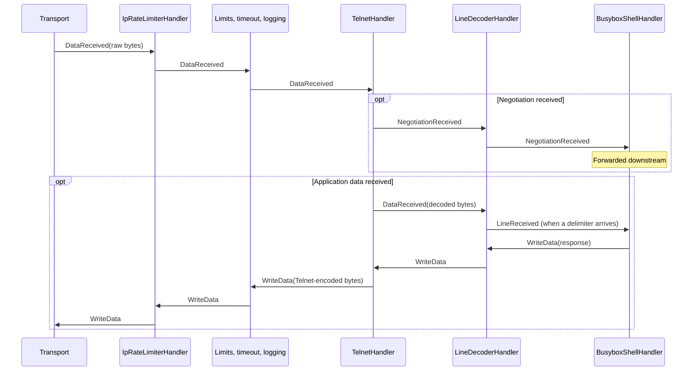

# HoneyPotter 🍯

*The Boy Who Logged.*

[](https://github.com/honeypotterdev/honeypotter/actions/workflows/qa.yml)

An experimental Python honeypot for Telnet, Redis, MQTT, and raw TCP. It powers the deployed collectors behind [honeypotter.dev](https://honeypotter.dev).

This is a **work in progress**, started for fun and learning. The protocol parsers and handler pipeline are implemented by hand to explore networking, state machines, and what happens when the internet knocks. The pipeline runs on Python's `asyncio` and takes inspiration from Java's [Netty](https://netty.io/wiki/index.html).

This repository contains the honeypot component. The website's backend and frontend live separately and are planned for a future release.

## Try it

With [uv](https://docs.astral.sh/uv/getting-started/installation/) installed, run any of these commands in a separate terminal. Honeypotter requires Python 3.14.3 or newer; uv can download a compatible interpreter automatically.

```bash
# Telnet with an emulated BusyBox shell
uvx honeypotter -v telnet --port 2323

# Redis
uvx honeypotter -v redis --port 6379

# MQTT
uvx honeypotter -v mqtt --port 1883

# Raw TCP, listening on multiple ports
uvx honeypotter -v tcp --port 8080 --port 9090
```

Listeners bind to `127.0.0.1` by default. Add `--host 0.0.0.0` to listen on all IPv4 interfaces. The `-v` flag enables debug logging; use `uvx honeypotter <protocol> --help` for available options.

## Export observations

All four modes can export session records as JSON over HTTP when connections close:

```bash
uvx honeypotter telnet --port 2323 \
  --export-url https://collector.example.com/events \
  --export-header "Authorization: Bearer YOUR_TOKEN" \
  --export-header "X-Honeypot-Name: curious-wizard"
```

Replace the example URL with your collector endpoint, or a unique URL generated by [Webhook.site](https://webhook.site) to inspect requests with dummy header values. Running a honeypot does not automatically submit data to honeypotter.dev.

## From bytes to events

Each connection has a pipeline of handlers. Inbound events move forward; outbound commands travel back toward the transport. Handlers can forward, transform, or consume events.

Here's a simplified Telnet exchange after connection setup:



The grouped stage contains session duration and size limits, an idle timeout, and message logging, in that order. IP rate limiting happens on `ConnectionOpened`; data passes through afterward. Negotiation and application data produce separate events whose order depends on incoming bytes. The diagram omits negotiation replies and optional recording handlers.

## Development

From a checkout, run `uv sync --locked`, then `make test` or `make lint`.

## License

[MIT](LICENSE) © 2026 Vlad Dmitrievich.
