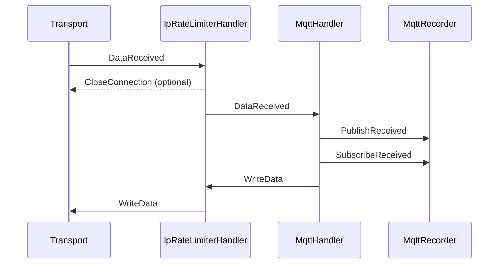

# HoneyPotter 🍯

*The Boy Who Logged*

[](https://github.com/honeypotterdev/honeypotter/actions/workflows/qa.yml)
[](https://github.com/honeypotterdev/honeypotter/actions/workflows/workflow-security.yml)

An experimental Python honeypot for Telnet, Redis, MQTT, and raw TCP. It powers the deployed collectors behind [honeypotter.dev](https://honeypotter.dev).

This is a **work in progress**, started for fun and learning. The protocol parsers and handler pipeline are implemented by hand to explore networking, state machines, and what happens when the internet knocks. The pipeline runs on Python's `asyncio` and takes inspiration from Java's [Netty](https://netty.io/).

This repository contains the honeypot component. The website's backend and frontend live separately and are planned for a future release.

## Try it

Run with [uv](https://docs.astral.sh/uv/getting-started/installation/):

Telnet with an emulated BusyBox shell:

```bash
uvx honeypotter -v telnet --port 2323
```

Redis:

```bash
uvx honeypotter -v redis --port 6379
```

MQTT:

```bash
uvx honeypotter -v mqtt --port 1883
```

Raw TCP, listening on multiple ports:

```bash
uvx honeypotter -v tcp --port 8080 --port 9090
```

Listeners bind to `127.0.0.1` by default. Add `--host 0.0.0.0` to listen on all IPv4 interfaces. The `-v` flag enables debug logging; use `uvx honeypotter <protocol> --help` for available options.

## Export observations

All four modes can export session records as JSON over HTTP when connections close:

```bash
uvx honeypotter telnet --port 2323 \
  --export-url https://collector.example.com/events \
  --export-header "Authorization: Bearer YOUR_TOKEN" \
  --export-header "X-Honeypot-Name: curious-wizard"
```

## From bytes to events

Each connection has a pipeline of handlers. Inbound events move forward; outbound commands travel back toward the transport. Handlers can forward, transform, or consume events.

For MQTT, for example, `DataReceived` events from the transport become MQTT-level events such as `PublishReceived` and `SubscribeReceived`:



Other handlers are omitted for clarity. The dashed arrow shows a possible rejection on `ConnectionOpened`; the remaining arrows illustrate an accepted connection. `MqttRecorder` is enabled when exporting.

## Development

From a checkout, run `uv sync --locked`, then `make test` or `make lint`.

## License

[MIT](LICENSE) © 2026 Vlad Dmitrievich.
